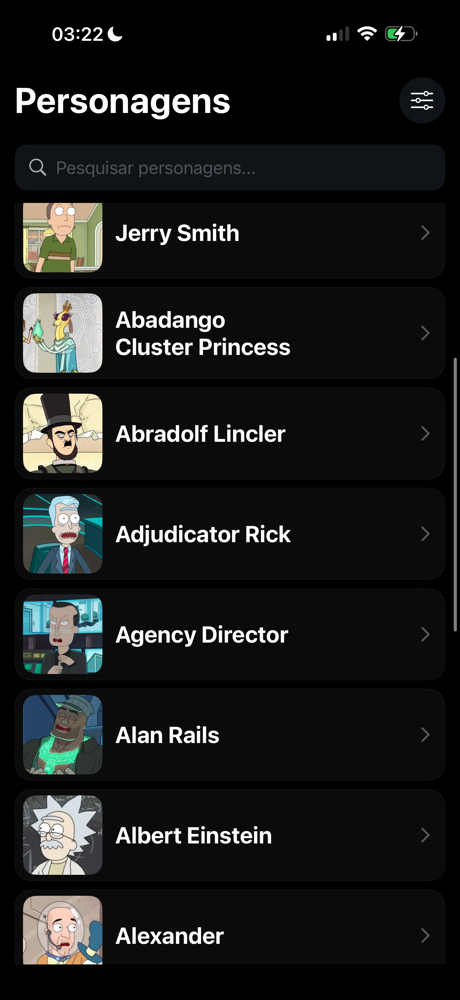
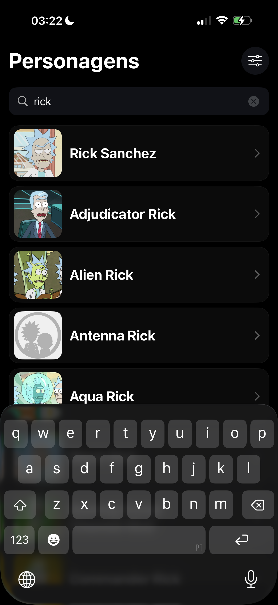
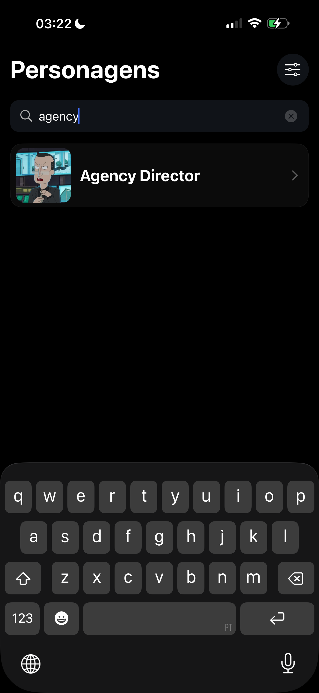
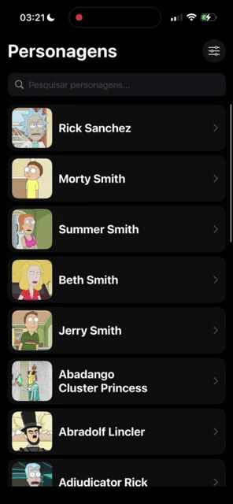
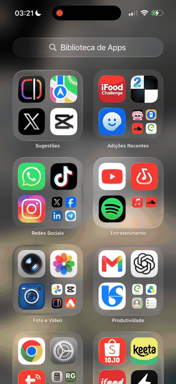

# Rick and Morty — Desafio iOS

Aplicação iOS para explorar personagens de Rick and Morty, consultar seus detalhes e combinar pesquisa por nome com filtros. A solução atende à proposta de desenvolver uma aplicação simples e funcional, com consumo de API, paginação e recuperação local da última consulta.

## Funcionalidades

- Lista de personagens com nome e foto, carregada por páginas conforme a rolagem.
- Pesquisa por nome com debounce de 350 ms.
- Filtros combináveis por status, espécie e gênero. A seleção é mantida como rascunho até tocar em **Aplicar filtros**; **Limpar filtros** redefine o rascunho.
- Detalhes do personagem: foto, identificador, status, espécie, tipo, gênero, origem e localização.
- Indicadores de carregamento, estado vazio e mensagens para falhas de conexão, timeout, servidor e interpretação da resposta.
- Nova tentativa da consulta inicial ou somente da página que falhou, preservando os resultados já carregados nesse segundo caso.
- Restauração dos resultados, pesquisa, filtros, próxima página e posição da lista ao reabrir o app.
- Cache de imagens em memória e disco, com placeholder durante o carregamento ou em caso de falha.
- Ícone personalizado e Launch Screen com imagem configurada no `Info.plist`.

## Demonstração

### Listagem e pesquisa

| Listagem de personagens | Pesquisa por “rick” | Pesquisa por “agency” |
| --- | --- | --- |
|  |  |  |

### Fluxos em vídeo

| Listagem, detalhes e filtros | Pesquisa e recuperação de falha de conexão |
| --- | --- |
|  |  |

Os GIFs mantêm a duração completa das gravações e repetem continuamente. Para abrir separadamente: [listagem, detalhes e filtros](docs/demos/listagem-detalhes-filtros.gif) e [pesquisa e recuperação de falha](docs/demos/gravacao-app.gif).

## Tecnologias utilizadas

| Tecnologia | Uso |
| --- | --- |
| Swift | Código da aplicação; modo de linguagem configurado como Swift 5. |
| UIKit e Auto Layout | Telas, tabela, navegação e layouts programáticos. |
| Ciclo de vida UIKit | Janela e navegação criadas no `SceneDelegate`; Launch Screen declarada no `Info.plist`. |
| Foundation e `URLSession` | Requisições HTTP, composição de URLs e persistência com `UserDefaults`. |
| Swift Concurrency | `async/await`, cancelamento de `Task`, `@MainActor` e isolamento do cache de imagens por `actor`. |
| `Codable` | Decodificação da API e serialização dos dados locais em JSON. |
| `NSCache`, `FileManager` e CryptoKit | Cache de imagens; SHA-256 da URL para gerar nomes de arquivos. |
| XCTest e `URLProtocol` | Testes automatizados com serviços simulados e interceptação de respostas HTTP. |

Não há dependências externas configuradas via Swift Package Manager, CocoaPods ou Carthage.

## Arquitetura e organização

A listagem segue MVVM: `CharacterListViewModel` mantém resultados e estados, coordena consultas e persistência e notifica a tela pela closure `onChange`. O `ViewController` recebe essas mudanças e atualiza a interface. Filtros e detalhes são controllers UIKit com responsabilidades locais, sem ViewModels adicionais.

```text
ifood-challenge/
├── AppDelegate.swift / SceneDelegate.swift
├── MVVM/
│   ├── Model/       Modelos da API, filtros e estado persistido
│   ├── View/        Lista, detalhes, filtros e RemoteImageView
│   ├── ViewModel/   CharacterListViewModel
│   ├── Services/    CharacterService e ImageLoader
│   └── Cache/       CodableStore, CharacterListStateStore e ImageCache
├── Resources/      AppStrings
└── Assets.xcassets/
```

A pasta `Tests/` fica na raiz do repositório e contém apenas `CharacterTests.swift`, vinculada ao target `ifood-challengeTests`.


## Persistência local

| Informação | Armazenamento | Recuperação |
| --- | --- | --- |
| Primeira página sem pesquisa ou filtros | JSON em `UserDefaults`, chave `characters.response.v1` | Consultada pelo serviço antes da rede. Buscas e outras páginas não sobrescrevem esse cache. |
| Última consulta concluída | JSON em `UserDefaults`, chave `characters.listState.v1` | Inclui personagens acumulados, pesquisa, filtros, próxima página, identificador e versão do estado. |
| Posição da lista | JSON em `UserDefaults`, chave `characters.listPosition.v1` | Vinculada ao estado e a um personagem existente, com deslocamento finito dentro da linha. |
| Imagens | `NSCache` e diretório `Caches/CharacterImages` | Busca primeiro em memória, depois em disco e, por último, na rede. |

Ao iniciar, o ViewModel prioriza o estado completo salvo. Se ele não estiver disponível ou for inválido, começa o carregamento inicial. O formato atual do estado usa **versão 2**, embora a chave mantenha o sufixo `.v1`; versões incompatíveis são descartadas junto com a posição.

Acrescentar páginas mantém a identidade da consulta e a posição salva. Uma nova pesquisa ou alteração de filtros cria outra identidade. Consultas com falha não substituem o último estado concluído; resultados vazios concluídos são persistidos.

O uso de `UserDefaults` serve à recuperação da sessão e ao cache da resposta inicial. Não há um armazenamento separado de preferências do usuário. É possível consultar os resultados já salvos sem rede, mas novas buscas e páginas ainda não carregadas dependem de conexão; fotos só ficam disponíveis offline se estiverem no cache.

## Integração com API

O serviço consulta o endpoint de personagens da Rick and Morty API:

```text
GET https://rickandmortyapi.com/api/character/
```

`URLComponents` monta os parâmetros `name`, `status`, `species` e `gender`. As próximas páginas usam a URL retornada em `info.next`, validando HTTPS, host e caminho antes da requisição. O timeout configurado é de 20 segundos.

Respostas HTTP de `200` a `299` são decodificadas em `CharacterPage`. Um `404` na primeira página de uma pesquisa ou filtro representa ausência de correspondências; nas páginas seguintes, é tratado como erro. Falhas de transporte, HTTP e decodificação são propagadas ao ViewModel, que produz mensagens para a interface.

Quando a página inicial falha, a tela apresenta a mensagem e **Tentar novamente**. Quando uma página adicional falha, a mensagem e o botão ficam no rodapé, mantendo a lista. A recuperação não realiza tentativas automáticas. Falhas de imagem mantêm o placeholder.

## Executando o projeto

### Requisitos

- macOS com Xcode compatível com o projeto, cujo formato e metadados registram Xcode 16.3.
- SDK de iOS 18.4 ou posterior e um simulador compatível instalado. O deployment target é **iOS 18.4**.
- Conexão com a internet para obter dados que ainda não estejam salvos.

### Pelo Xcode

1. Abra `ifood-challenge.xcodeproj`.
2. Selecione o esquema compartilhado **ifood-challenge**.
3. Escolha um simulador com iOS 18.4 ou posterior.
4. Execute com **⌘R**.

Não é necessário instalar bibliotecas, configurar variáveis de ambiente ou informar chave de API. Para executar em aparelho físico, ajuste a equipe de assinatura e, se necessário, o bundle identifier em **Signing & Capabilities** dos targets.

### Testes automatizados

Com o mesmo esquema e um simulador selecionados, pressione **⌘U**. Os resultados aparecem no Test Navigator (**⌘6**).

O target `ifood-challengeTests` contém oito testes em [CharacterTests.swift](Tests/CharacterTests.swift):

1. Mensagens de erro e recuperação, incluindo bloqueio de cliques repetidos.
2. Preservação da pesquisa e dos filtros ao tentar novamente.
3. Descarte de uma resposta cancelada após mudar a pesquisa.
4. Falha de paginação, repetição da página pendente, remoção de duplicatas e fim dos resultados.
5. Restauração da próxima página e dos filtros.
6. Descarte de uma página pendente após mudar os filtros.
7. Persistência, preservação da posição e invalidação do estado antigo.
8. Serviço com HTTP simulado: páginas, cache, parâmetros, respostas `404` e rejeição de URL externa.

Os testes usam serviços simulados, `UserDefaults` isolado e `URLProtocol`, sem depender da API real. Não há testes automatizados de interface ou de carregamento de imagens nessa suíte.

## Limitações e possíveis evoluções

- **Atualização dos dados:** os caches e o estado salvo não expiram automaticamente, e não há ação de atualizar a lista. Uma evolução seria permitir atualização explícita ou definir uma política de validade.
- **Volume persistido:** o estado completo é serializado a cada página, e seu conteúdo anterior é decodificado para comparar a identidade. Para volumes maiores, convém medir o custo antes de mudar a estratégia de armazenamento.
- **Cache em disco:** não há limpeza por idade ou tamanho implementada pelo app. O sistema pode remover arquivos do diretório de caches.
- **Localização:** textos fixos estão em português no catálogo de constantes; não há arquivos de localização. Alguns valores dos personagens são exibidos como recebidos da API.
- **Validação da interface:** rolagem, layouts, Launch Screen e acessibilidade exigem verificação no simulador ou dispositivo; os oito testes não exercitam esses aspectos visuais.

Essas evoluções não fazem parte das funcionalidades entregues.
